# Supply Chain Efficiency Optimization Using Advanced Power BI Visualizations

Data Analytics & Visualization (DAV) – Complex Engineering Problem
SIES Graduate School of Technology, Department of Computer Engineering

An interactive Microsoft Power BI dashboard that turns the DataCo order-item data (180,519 records, January 2015 – January 2018) into clear answers to two questions: **where do deliveries run late, and where is profit earned?**

---

## Table of Contents

1. [Project Overview](#project-overview)
2. [Key Findings](#key-findings)
3. [Repository Contents](#repository-contents)
4. [Dataset](#dataset)
5. [Architecture and Workflow](#architecture-and-workflow)
6. [Data Model](#data-model)
7. [KPI Definitions (DAX)](#kpi-definitions-dax)
8. [Dashboard Pages](#dashboard-pages)
9. [Scenario Analysis](#scenario-analysis)
10. [Additional Observations](#additional-observations)
11. [Testing and Validation](#testing-and-validation)
12. [How to Run](#how-to-run)
13. [Requirements](#requirements)
14. [Limitations](#limitations)
15. [Future Scope](#future-scope)
16. [Team](#team)
17. [References](#references)

---

## Project Overview

Supply-chain managers usually hold delivery and sales information in large transactional files that are hard to read without visual analytics. This project builds a three-page Power BI report that links delivery performance with sales and profit, so problem areas can be found in seconds.

**Objectives**

- Prepare, validate and model the DataCo order-item data in Power BI.
- Define transparent KPIs with DAX: late-delivery rate, cancellation rate, average delay days, net sales, profit and profit margin.
- Build a three-page interactive dashboard with slicers and cross-filtering.
- Identify the main drivers of late delivery and the concentration of sales and profit by region and category.
- Recommend improvements aligned with UN SDG 9 (Industry, Innovation and Infrastructure) and SDG 12 (Responsible Consumption and Production).

**Scope:** descriptive and diagnostic analytics at order-item level for orders placed between 1 January 2015 and 31 January 2018. No machine learning is used.

---

## Key Findings

| Metric | Value |
|---|---|
| Order items / orders | 180,519 / 65,752 |
| Gross sales / discounts | $36.78M / $3.73M |
| Net sales / implied cost | $33.05M / $29.09M |
| Profit / margin | $3.97M / 12.00% |
| Late rate (delivered items) | 57.29% |
| Cancellation rate | 4.30% |
| Average delay (valid rows) | 0.57 days |
| Loss-making items | 33,784 (18.7%) |

- **Shipping mode, not region, drives lateness.** Late rate by mode: First Class 100.0%, Second Class 79.8%, Same Day 47.9%, Standard Class 39.8%. Late rates across regions are similar (51.6% in Canada to 60.1% in Central Africa).
- **The cause is the promise.** First Class promises 1 day but takes about 2, so every item is late. Second Class promises 2 days but takes about 4.
- **Profit is concentrated.** Fishing ($756K), Cleats ($495K) and Camping & Hiking ($427K) give 42% of profit; the nine largest categories give 88%.
- **Top regions.** Western Europe and Central America earn the most profit ($625K and $616K, together 31.3% of total).
- **Resetting promises helps.** Aligning delivery promises with observed days could cut the late rate from 57.3% to about 31.5% (an estimate, see [Scenario Analysis](#scenario-analysis)).

---

## Repository Contents

```
.
├── README.md
├── Supply_Chain_Efficiency_Optimization_file.pbix   # Power BI report (3 pages)
├── Supply_Chain_DAV_Report.docx                     # Full project report
├── data/
│   └── Fact_OrderItems_PowerBI_Ready.csv            # Source data (add before running)
└── images/                                          # Figures used in this README
```

> The `data/` folder is not included in this upload. Add the CSV there (or anywhere on your machine) and point the report to it, as described in [How to Run](#how-to-run).

---

## Dataset

**Source:** DataCo Smart Supply Chain for Big Data Analysis, Mendeley Data (see [References](#references), [1]).

| Item | Description |
|---|---|
| Format | CSV, 180,519 rows × 43 columns (about 49 MB), one row per order item |
| Orders | 65,752 distinct orders |
| Period | 1 Jan 2015 – 31 Jan 2018 (37 months) |
| Coverage | 164 countries, 23 regions, 50 product categories, 4 shipping modes, 4 delivery statuses, 9 order statuses |
| Preparation | Fact table joined with its category, geography, shipping-mode, delivery-status and date dimension tables into one enriched table |

**Main attribute groups**

| Group | Attributes |
|---|---|
| Identifiers and keys | Order_Item_Id, Order_Id, Geo_Key, Category_Key, Mode_Key, Delivery_Status_Key, Order_Date_Key, Ship_Date_Key |
| Dates | Order_Date, Ship_Date and derived year, quarter, month, year-month and weekday fields |
| Financial | Quantity, Gross_Sales, Discount, Net_Sales, Implied_Cost, Profit |
| Delivery | Days_Real, Days_Scheduled (_x, _y), Delay_Days, Late_Risk, Is_Late, Is_Cancelled_Shipment, Is_Loss_Making, Stage_Order |
| Dimensions | Category, Country, Region, Shipping_Mode, Delivery_Status, Order_Status |

**Data quality checks:** no duplicate rows, Order_Item_Id is unique, no missing dimension attributes, Net_Sales = Gross_Sales − Discount in every row, and no shipment is dated before its order. Delay_Days is blank for the 7,754 cancelled shipments only. These blanks are deliberately kept (not replaced with zero) because a cancelled order has no realised delay.

---

## Architecture and Workflow

The solution is a five-stage pipeline: source → ETL (Power Query) → data model → visualisation → outcome.

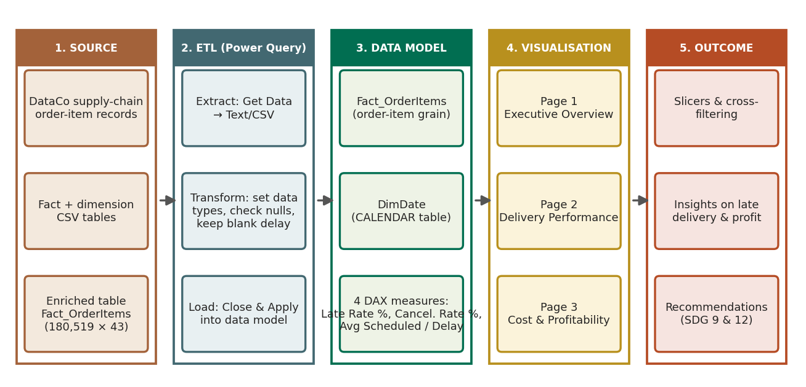

**ETL steps (Power Query)**

1. **Extract:** Home → Get data → Text/CSV (43 columns, Windows-1252 encoding).
2. **Transform:** promote headers; set types deliberately (keys and counts as whole numbers, dates as date/date-time, amounts as decimal, text as text); check column quality for errors and nulls; keep Delay_Days blank for cancelled shipments.
3. **Load:** Close & Apply loads the table `Fact_OrderItems`; the calendar table `DimDate` is added with DAX.

---

## Data Model

The data is a flattened star: dimensions are pre-joined into the single fact table `Fact_OrderItems`. `DimDate` is a stand-alone DAX calendar table with no relationship, and the report uses the fact table's own date fields with Power BI's date hierarchy.

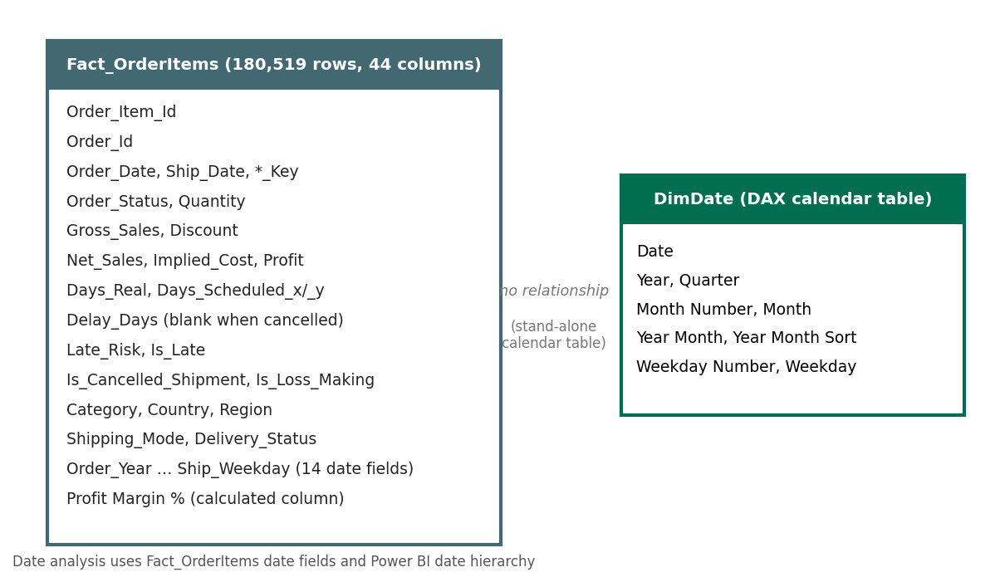

---

## KPI Definitions (DAX)

Late delivery means actual shipping days exceed scheduled days (`Delay_Days > 0`). Cancelled shipments are excluded from the late-rate denominator because they have no realised delivery.

```DAX
Late Rate % =
DIVIDE (
    CALCULATE ( DISTINCTCOUNT ( Fact_OrderItems[Order_Item_Id] ), Fact_OrderItems[Is_Late] = 1 ),
    CALCULATE ( DISTINCTCOUNT ( Fact_OrderItems[Order_Item_Id] ), Fact_OrderItems[Is_Cancelled_Shipment] = 0 )
)

Cancellation Rate % =
DIVIDE (
    CALCULATE ( DISTINCTCOUNT ( Fact_OrderItems[Order_Item_Id] ), Fact_OrderItems[Is_Cancelled_Shipment] = 1 ),
    DISTINCTCOUNT ( Fact_OrderItems[Order_Item_Id] )
)

Average Scheduled Days = AVERAGE ( Fact_OrderItems[Days_Scheduled_x] )

Average Delay Days = AVERAGE ( Fact_OrderItems[Delay_Days] )

Profit Margin % = DIVIDE ( SUM ( Fact_OrderItems[Profit] ), SUM ( Fact_OrderItems[Net_Sales] ) )
```

Calendar table:

```DAX
DimDate =
VAR StartDate = MIN ( MIN ( Fact_OrderItems[Order_Date] ), MIN ( Fact_OrderItems[Ship_Date] ) )
VAR EndDate   = MAX ( MAX ( Fact_OrderItems[Order_Date] ), MAX ( Fact_OrderItems[Ship_Date] ) )
RETURN
ADDCOLUMNS (
    CALENDAR ( StartDate, EndDate ),
    "Year", YEAR ( [Date] ),
    "Quarter", "Q" & FORMAT ( [Date], "Q" ),
    "Month Number", MONTH ( [Date] ),
    "Month", FORMAT ( [Date], "MMMM" ),
    "Year Month", FORMAT ( [Date], "YYYY-MM" ),
    "Year Month Sort", YEAR ( [Date] ) * 100 + MONTH ( [Date] ),
    "Weekday Number", WEEKDAY ( [Date], 2 ),
    "Weekday", FORMAT ( [Date], "dddd" )
)
```

KPI calculation logic (evaluated for whatever rows survive the current slicer or cross-filter):

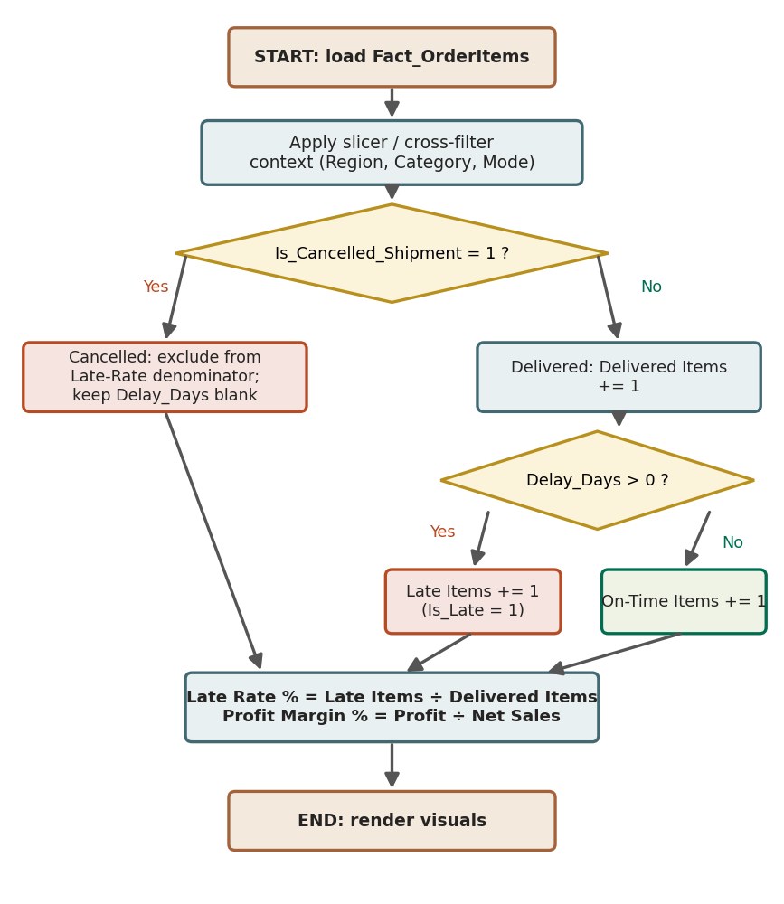

---

## Dashboard Pages

The report uses a 1920 × 1080 canvas and the "Frontier" colour theme. Every visual can be clicked to cross-filter the others (hold Ctrl for multi-select, click an empty area to clear).

### Page 1 – Executive Overview

Slicers (Region, Category, Shipping Mode), Late Rate % by shipping mode, Net Sales by year, and Profit by region.

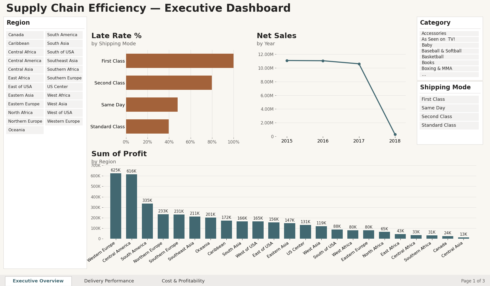

With Region = Western Europe and Shipping Mode = Standard Class, every visual updates (Standard Class 40.2% late, Western Europe profit $355K):

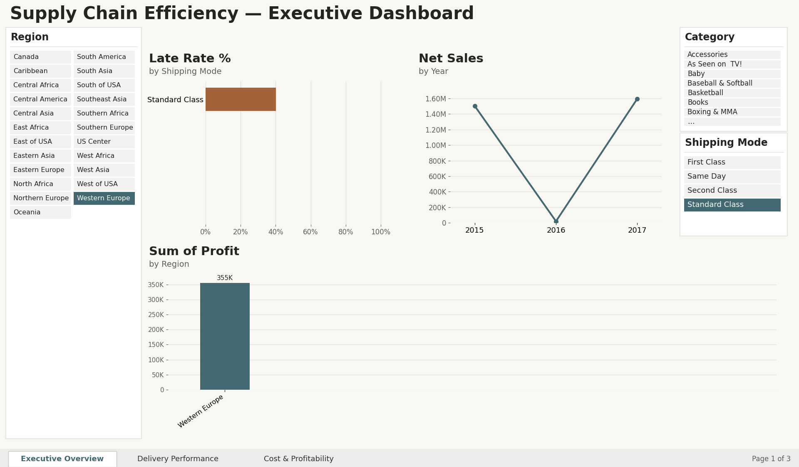

### Page 2 – Delivery Performance

KPI cards (Late Rate %, Cancellation Rate %, Average Delay Days), late rate and scheduled-vs-delay charts by shipping mode, and a detail table by region, mode and delivery status.

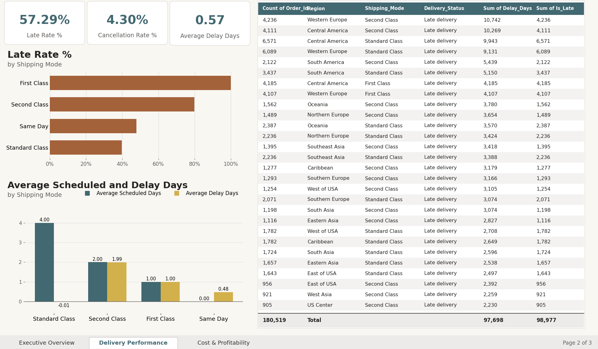

| Shipping mode | Items | Scheduled days | Actual days (avg) | Avg delay (days) | Late rate |
|---|---|---|---|---|---|
| Standard Class | 107,752 | 4 | 4.00 | -0.01 | 39.8% |
| Second Class | 35,216 | 2 | 3.99 | 1.99 | 79.8% |
| First Class | 27,814 | 1 | 2.00 | 1.00 | 100.0% |
| Same Day | 9,737 | 0 | 0.48 | 0.48 | 47.9% |

Delivery status mix by shipping mode (share of all items):

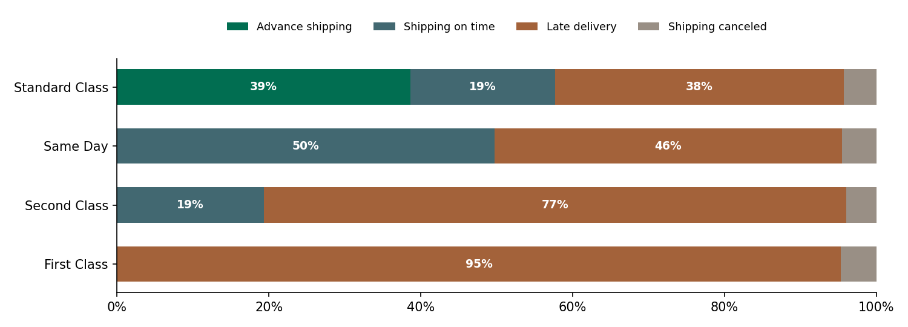

Clicking the First Class bar filters the cards and table (Late Rate 100.00%, 27,814 items):

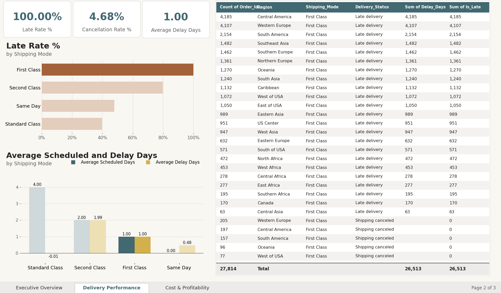

### Page 3 – Cost & Profitability

KPI cards (Net Sales, Implied Cost, Profit, Profit Margin %), profit by category and net sales by region.

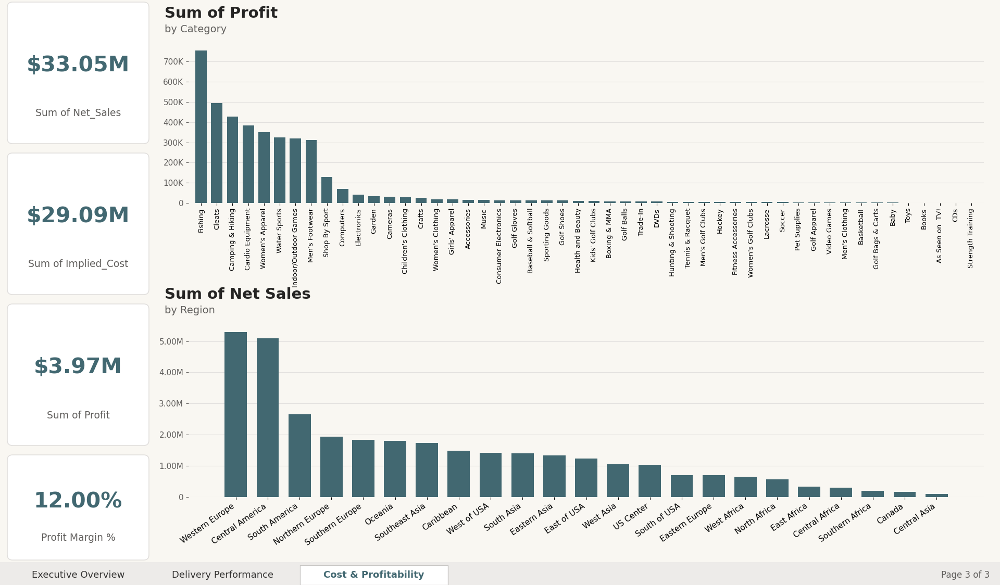

Selecting the Fishing category shows net sales of $6.23M, profit of $756K and a 12.14% margin:

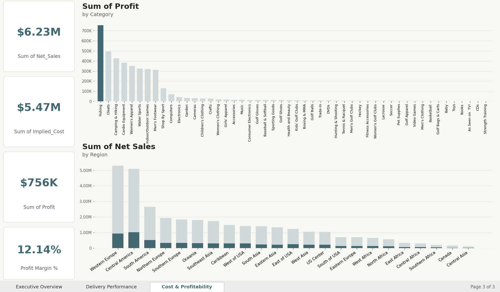

Weak spots are small categories such as Strength Training (0.7% margin), As Seen on TV! (3.9%) and Men's Clothing (5.1%). Loss-making items (33,784) lose $3.88M, offsetting $7.85M of gains.

---

## Scenario Analysis

Because lateness is driven by the promised days, the late rate was recalculated in Python (pandas) under revised promises, using the actual days already observed:

```
FOR EACH delivered item i:
    new_schedule[i] <- proposed promise for Shipping_Mode[i]
    late_new[i]     <- 1 IF Days_Real[i] > new_schedule[i] ELSE 0
LateRate_new <- SUM(late_new) / delivered
```

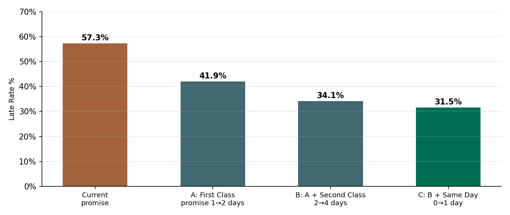

| Scenario | Late rate |
|---|---|
| Current promise | 57.3% |
| A: First Class promise 1 → 2 days | 41.9% |
| B: A + Second Class 2 → 4 days | 34.1% |
| C: B + Same Day 0 → 1 day | 31.5% |

This is an estimate of reporting-level lateness, not a forecast of carrier behaviour. It does not model carrier capacity or customer reaction.

---

## Additional Observations

Two patterns need care when interpreting the dashboard:

1. **Volume drops sharply from October 2017** (5,189 items in September 2017 versus 2,255 in October), which looks like a data cut-off rather than a real fall in demand. 2018 contains January only.

   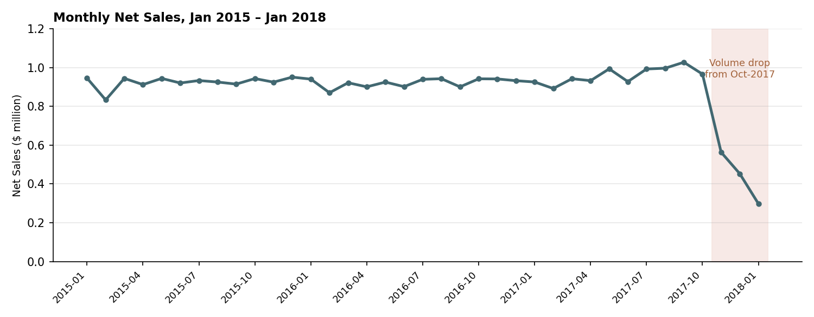

2. **Regional coverage differs by year.** The three US regions and several others appear only in 2016, while Western Europe, Central America and South America appear almost only in 2015 and 2017.

   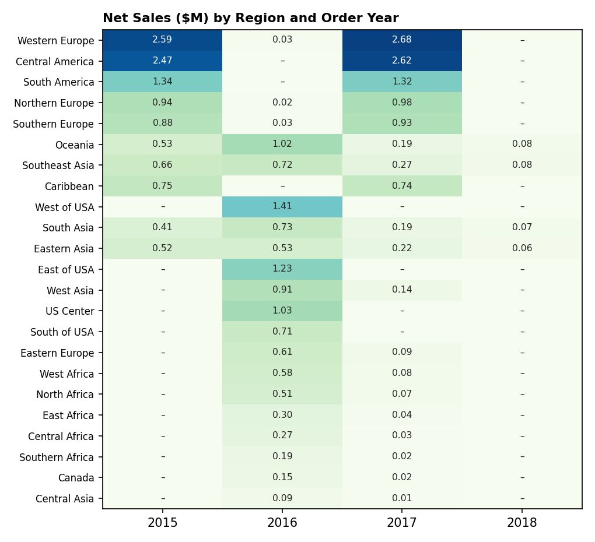

---

## Testing and Validation

Each KPI was recalculated independently from the source CSV with Python (pandas) and compared with the Power BI measure. Interaction tests applied slicer selections and cross-filter clicks and confirmed that cards, charts and the table update consistently.

| Test | Expected | Actual | Status |
|---|---|---|---|
| T1 Data load | 180,519 rows; 43 columns | 180,519 rows; 43 columns (+1 calculated column) | Pass |
| T2 Key uniqueness | Distinct Order_Item_Id = row count | 180,519 = 180,519 | Pass |
| T3 Blank delays | 7,754 blanks, all cancelled | 7,754; all Is_Cancelled_Shipment = 1 | Pass |
| T4 Late Rate % | 98,977 ÷ 172,765 = 57.29% | 57.29% | Pass |
| T5 Cancellation Rate % | 7,754 ÷ 180,519 = 4.30% | 4.30% | Pass |
| T6 Average Delay Days | 0.57 | 0.57 | Pass |
| T7 Sales cards | $33.05M; $29.09M; $3.97M | $33.05M; $29.09M; $3.97M | Pass |
| T8 Profit Margin card (sum of row-level margin) | Ratio near 12% | 21,743 (meaningless) | Fail |
| T9 Profit Margin card (fixed with DIVIDE) | 12.00% | 12.00% | Pass (after fix) |
| T10 Slicer: Western Europe + Standard Class | 40.2% late; $355K profit | 40.2%; $355K | Pass |
| T11 Cross-filter: First Class (page 2) | 100.00%; 4.68%; 1.00; 27,814 | 100.00%; 4.68%; 1.00; 27,814 | Pass |
| T12 Cross-filter: Fishing (page 3) | $6.23M; $756K; 12.14% | $6.23M; $756K; 12.14% | Pass |

**Defect found and fixed:** T8 showed that `Profit Margin %` in the model was a row-level calculated column, so summing it on a card is meaningless. It was replaced by a measure dividing total profit by total net sales (T9).

---

## How to Run

1. Install **Power BI Desktop** (Windows).
2. Download or clone this repository and keep the `.pbix` and the CSV on a local drive.
3. Open `Supply_Chain_Efficiency_Optimization_file.pbix`.
4. If Power BI cannot find the data file: **Transform data → Data source settings → Change Source**, then point to `Fact_OrderItems_PowerBI_Ready.csv`.
5. Click **Refresh**, then use the page tabs at the bottom to move between the three pages.
6. Use the Region, Category and Shipping Mode slicers on page 1, or click any bar, column or table row, to filter the other visuals.

---

## Requirements

| Category | Requirement |
|---|---|
| Software | Microsoft Power BI Desktop (Windows); Power Query (M) and DAX; Python 3 with pandas and matplotlib (only for verification and the extra figures) |
| Hardware | Windows 10/11 PC, 8 GB RAM recommended (4 GB minimum), 2 GB free disk space, 1920 × 1080 display |
| Input | `Fact_OrderItems_PowerBI_Ready.csv` |
| Output | `.pbix` report with 3 pages, KPI results, insights and recommendations |

---

## Limitations

- Single-table model with a stand-alone calendar table, so there is no relationship-based time intelligence.
- Profit and Implied_Cost are dataset-defined, not audited accounting figures. There is no transport-cost or warehouse field, so warehouse-level and transport-cost analysis are out of scope.
- Uneven regional coverage by year and a partial last quarter limit trend conclusions.
- The scenario analysis re-labels promises using observed days.

---

## Future Scope

- Add transport-cost and warehouse fields.
- Build a proper star schema with relationships to `DimDate` and the dimension tables.
- Add drill-through pages, tooltips and a what-if parameter for promise days.
- Train a predictive model on the `Late_Risk` flag.
- Publish to Power BI Service with scheduled refresh and row-level security.

---

## Recommendations (SDG 9 and SDG 12)

1. Re-set First Class and Second Class delivery promises to match capability, or invest in faster real service (SDG 9).
2. Shift volume towards Standard Class, where promises are reliably met.
3. Review discounts and pricing in low-margin categories to cut loss-making items and waste (SDG 12).
4. Fix data coverage and the October 2017 cut-off before making trend decisions.

---

## Team

| Name | Roll No. |
|---|---|
| Kshitij Mane | 124A1076 |
| Atharva Matale | 124A1078 |
| Trushna Mhatre | 124A1080 |
| Mayank Mishra | 124A1082 |
| Mohammed Fowz | 124A1083 |
| Shrivenkatesh Kannan | 124A1097 |
| Umeshraj Nadar | 124A1099 |
| Shruti Nagare | 124A1100 |
| Praveen Naidu | 124A1102 |
| Arohi Pathak | 124A1116 |
| Kapish Patil | 124A1119 |
| Bhardwaj Rai | 124A1128 |

---

## References

1. F. Constante, F. Silva and A. Pereira, "DataCo SMART SUPPLY CHAIN FOR BIG DATA ANALYSIS," Mendeley Data, V5, 2019. doi: 10.17632/8gx2fvg2k6.5
2. S. Chopra and P. Meindl, *Supply Chain Management: Strategy, Planning, and Operation*, 6th ed. Pearson, 2016.
3. M. Christopher, *Logistics & Supply Chain Management*, 5th ed. Pearson, 2016.
4. G. Wang, A. Gunasekaran, E. W. T. Ngai and T. Papadopoulos, "Big data analytics in logistics and supply chain management: Certain investigations for research and applications," *Int. J. Production Economics*, vol. 176, pp. 98–110, 2016.
5. S. Few, *Information Dashboard Design: The Effective Visual Communication of Data*. O'Reilly Media, 2006.
6. R. Kimball and M. Ross, *The Data Warehouse Toolkit*, 3rd ed. Wiley, 2013.
7. M. Russo and A. Ferrari, *The Definitive Guide to DAX*, 2nd ed. Microsoft Press, 2019.
8. Microsoft, "Power BI documentation," Microsoft Learn. https://learn.microsoft.com/power-bi/
9. United Nations, "Transforming our world: the 2030 Agenda for Sustainable Development," A/RES/70/1, 2015.
